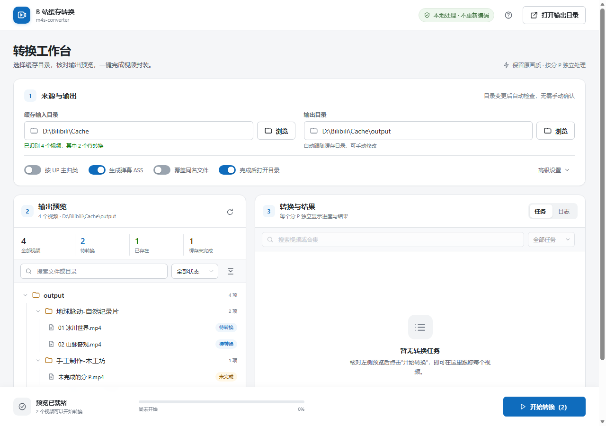
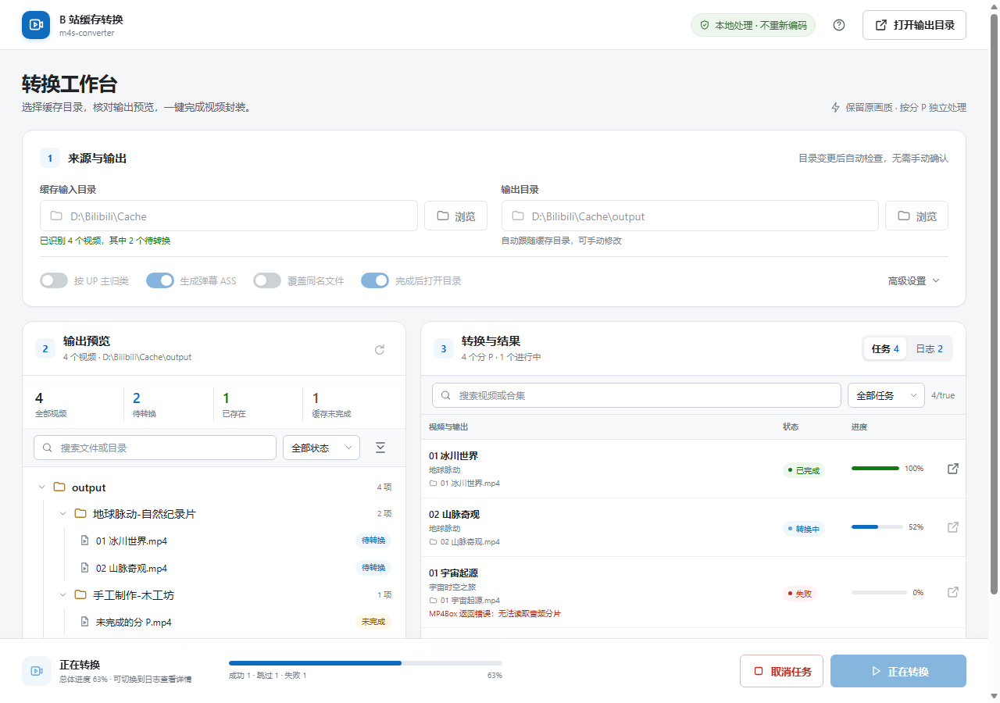
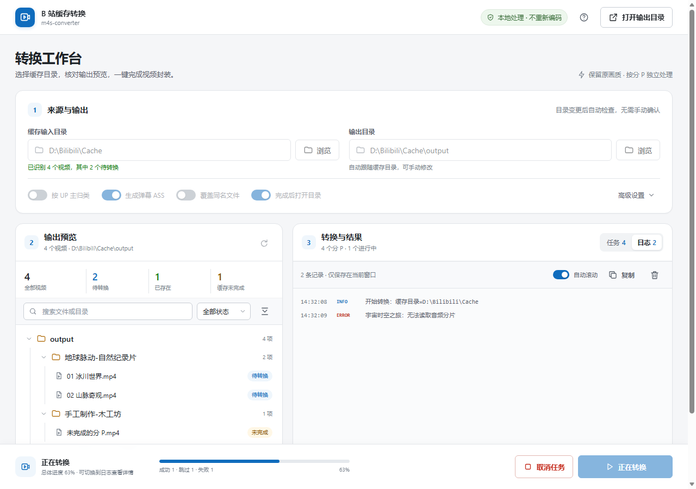

# B 站缓存转换（m4s-converter）

## Fork 说明

本仓库是 [mzky/m4s-converter](https://github.com/mzky/m4s-converter) 的 GitHub fork，用于保存与分发界面优化版本。

- 上游项目：<https://github.com/mzky/m4s-converter>
- 本 fork：<https://github.com/daohang-sun/m4s-converter>
- 主要改动：重构 GUI 界面与交互流程，完善输出预览、任务状态、日志工具和窗口图标。
- 许可：继续沿用上游 MIT License；本 fork 的修改归属见 [LICENSE](LICENSE)。

## 为什么开发此程序？

bilibili 下架了很多视频，之前收藏和缓存的视频均无法播放。


- 收藏的视频建议缓存起来，使用本程序将缓存的音视频 m4s 文件合并成 mp4，方便再次播放。
- 本工具使用 GPAC 的 MP4Box 进行音视频合成，能够确保合成后的视频质量和同步性。

## 下载

请优先从本 fork 的 Releases 页面下载：

- Windows GUI：`m4s-converter-gui.exe`
- 本 fork 发布页：<https://github.com/daohang-sun/m4s-converter/releases>
- 上游发布页：<https://github.com/mzky/m4s-converter/releases/latest>

## 界面预览

以下截图来自当前 fork 版本的运行界面，图中的路径与视频名称为演示数据，用于展示界面布局和状态反馈。







## 本地构建

需要 Go 1.23 及以上版本。

```powershell
# Windows GUI
go build -tags windows -ldflags "-H=windowsgui -w -s" -o m4s-converter-gui.exe ./cmd/m4s-converter-gui

# Windows CLI
go build -tags windows -ldflags "-w -s" -o m4s-converter-amd64.exe
```

也可以使用 `build.sh` 构建多平台版本。仓库内置 Windows 使用的 MP4Box；如需自定义，可通过 GUI 的“高级设置”或命令行 `-g` 参数指定。

## 自动发布

推送形如 `v1.0.0`、`v1.5.7-fork.1` 的 `v*` 标签时，GitHub Actions 会自动完成测试、构建 Windows GUI/CLI，并将产物上传到 Release。
也可以在仓库 Actions 页面手动触发 `Release` 工作流。

## 使用说明

### Android 手机端合并文件方法

- 详见：[拷贝文件与合成方法](https://github.com/mzky/m4s-converter/issues/9)

### 除 Windows 和 Linux 外，其它环境的依赖工具安装

- 详见：[依赖工具安装](https://github.com/mzky/m4s-converter/wiki/%E4%BE%9D%E8%B5%96%E5%B7%A5%E5%85%B7%E5%AE%89%E8%A3%85)

### 命令行参数

```text
# 指定MP4Box路径: ./m4s-converter-amd64.exe -g "D:\GPAC\mp4box.exe" 或 ./m4s-converter-amd64 -g select
 Flags: 
    -h --help         查看帮助信息
    -v --version      查看版本信息
    -a --assoff       关闭自动生成弹幕功能，默认不关闭
    -o --overlay      合成文件时是否覆盖同名视频，默认不覆盖并重命名新文件
    -u --summarize    将未合并的MP3和视频文件放入汇总目录，默认不汇总
    -c --cachepath    自定义视频缓存路径，默认使用bilibili的默认缓存路径
    -g --gpacpath     自定义GPAC的mp4box文件路径,值为select时弹出选择对话框
```

### 验证合成

```text
2023-12-05_16:02:46 [INFO ] 已合成视频文件:中国-美景极致享受-笨蹦崩.mp4
2023-12-05_16:02:46 [INFO ] ==========================================
2023-12-05_16:02:46 [INFO ] 合成的文件:
C:\Users\mzky\Videos\bilibili\output\【获奖学生动画】The Little Poet 小诗人｜CALARTS 2023\【获奖学生动画】The Little Poet 小诗人｜CALARTS 2023-toh糖.mp4
C:\Users\mzky\Videos\bilibili\output\【电影历史_专题片】《影响》致敬中国电影40年【全集】\40年光影记忆-开飞机的巡查司.mp4
C:\Users\mzky\Videos\bilibili\output\“我不是个好导演”，听田壮壮讲述“我和电影的关系”\“我不是个好导演”，听田壮壮讲述“我和电影的关系”-Tatler的朋友们.mp4
C:\Users\mzky\Videos\bilibili\output\【4K8K-世界各地的美景】\中国-美景极致享受-笨蹦崩.mp4
2023-12-05_16:02:46 [INFO ] 已完成本次任务，耗时:5秒
2023-12-05_16:02:46 [INFO ] ==========================================
按回车键退出...
```

- 合成 1.46GB 文件，耗时: 5 秒
- 合成 11.7GB 文件，耗时:38 秒

以上为固态硬盘测试结果，仅供参考。

## 致谢

- 上游项目：[mzky/m4s-converter](https://github.com/mzky/m4s-converter)
- 弹幕 XML 转 ASS：[kafuumi/converter](https://github.com/kafuumi/converter)
- 视频合成工具：[GPAC / MP4Box](https://gpac.io)
- 本工具无下载视频功能，仅重新封装本地缓存文件

## AI 辅助说明

本项目在界面重构、文档整理和自动化脚本编写过程中使用了 AI 辅助。
所有提交前的代码、文档与发布内容均由仓库维护者检查和确认，最终责任由维护者承担。

## 反馈

- 本 fork 的界面优化问题：[daohang-sun/m4s-converter Issues](https://github.com/daohang-sun/m4s-converter/issues)
- 上游功能缺陷或建议：[mzky/m4s-converter Issues](https://github.com/mzky/m4s-converter/issues/new/choose)

## 许可与归属

本项目使用 [MIT License](LICENSE)。原始项目版权与上游声明保留；本 fork 中新增的界面与工程修改也按 MIT License 分发。

## ⚠️ 法律声明

使用本工具即表示您同意[免责声明](免责声明.md)。  
仅允许转换您本人在视频下架前通过官方客户端合法缓存的内容，且转换结果**严格限于个人备份**，禁止传播与商用。
